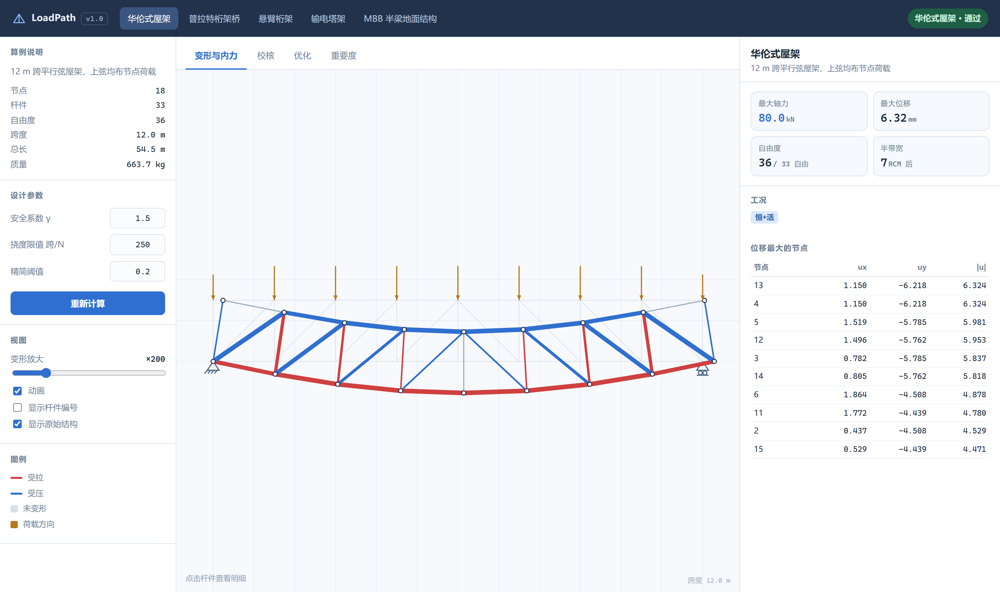
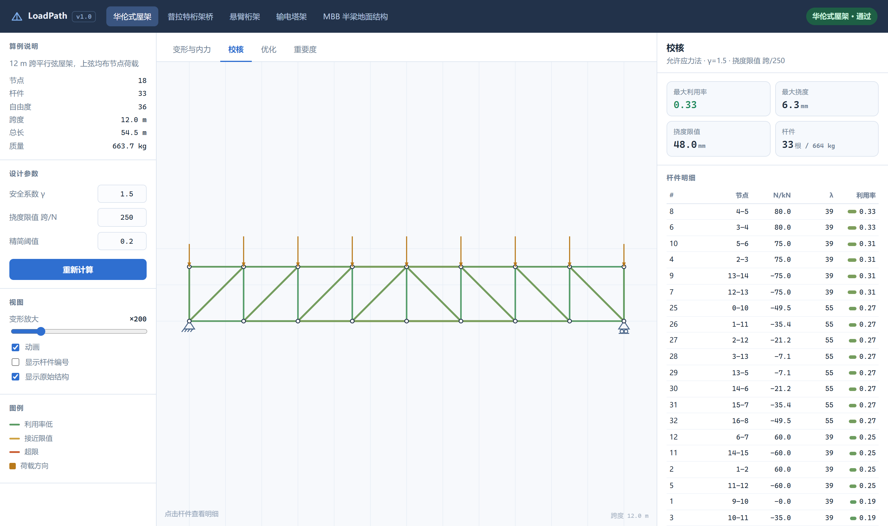
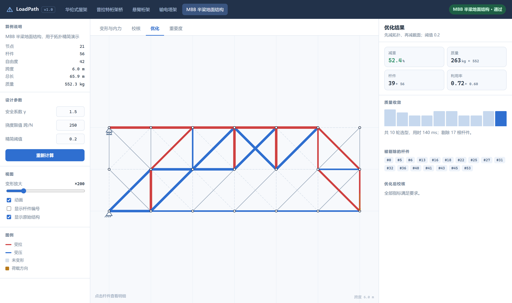
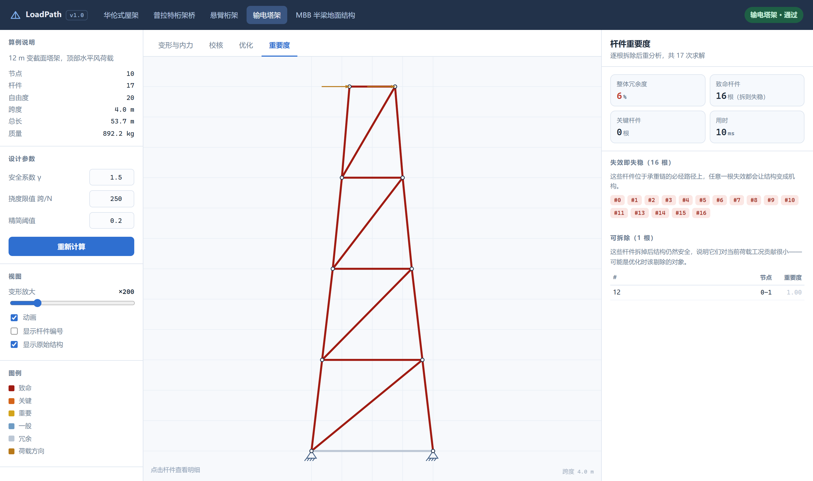

# LoadPath

**二维桁架受力分析、截面选型与杆件重要度工作台。**

纯 Python 标准库实现的桁架专用有限元求解器：从建模、静力分析、规范校核，到离散截面选型、拓扑精简、单杆失效扫描，一条链路走完；自带命令行、HTTP API 和一个手写的 Canvas 交互工作台。

[](https://github.com/18971181532/loadpath/actions/workflows/tests.yml)
[](https://github.com/18971181532/loadpath)
[](https://github.com/18971181532/loadpath)
[](LICENSE)



---

## 目录

- [项目简介](#项目简介)
- [核心功能](#核心功能)
- [环境与依赖](#环境与依赖)
- [安装与运行](#安装与运行)
- [使用示例](#使用示例)
- [内置算例与结果](#内置算例与结果)
- [技术方案](#技术方案)
- [目录结构](#目录结构)
- [测试与精度验证](#测试与精度验证)
- [设计取舍](#设计取舍)
- [已知限制](#已知限制)
- [License](#license)

---

## 项目简介

桁架是结构工程里最"可算"的一类结构：所有杆件只受轴力，节点视为铰接，力学模型干净到可以用手算校核。但真正做一次完整的桁架设计，需要的不只是"能解方程"：

- 解出来以后，杆件是拉是压、够不够、稳不稳？
- 12 种常用圆钢管里，每种杆件到底该选哪一档？
- 有些杆件纯属冗余，能不能拆？拆了以后结构还站得住吗？
- 哪几根杆一旦失效，整个结构立刻变成机构？

LoadPath 把这四个问题串成了一条流水线，并且**全部用 Python 标准库实现**——没有 NumPy、没有 SciPy、没有第三方求解器。刚度矩阵组装、带状 LDLᵀ 分解、屈曲校核、优化迭代都是手写的，因此每一步都能被读懂、被测试、被手算核对。

精度上，求解器与解析解的相对误差在 `4.4e-16` 量级（双精度机器精度），Betti 互等定理的数值验证差值为 `0`。

---

## 核心功能

| 能力 | 说明 |
| --- | --- |
| **建模** | 节点 / 杆件 / 支座 / 荷载工况 / 材料 / 截面，支持分组、指定位移（沉降）、自定义截面 |
| **静力分析** | 二力杆有限元，多工况共享一次矩阵分解，输出位移、轴力、支座反力、应变能 |
| **规范校核** | 允许应力法：强度、欧拉屈曲、长细比限值、挠度限值，逐杆给出控制工况与利用率 |
| **截面选型** | 在 12 种 CHS 圆钢管目录上做离散满应力迭代，强度 + 挠度双约束 |
| **拓扑精简** | 逐轮拆除低利用率杆件，拆完立即重分析，只保留"拆了也不出事"的杆 |
| **重要度扫描** | 逐根拆除 + 重分析，量化"这根杆有多重要"，识别致命杆与冗余杆 |
| **报告导出** | 定宽文本表格 / Markdown 报告（含优化对比与重要度表） |
| **HTTP API** | 7 个端点，纯 JSON，无框架（`http.server`） |
| **Web 工作台** | 手写 Canvas 2D：变形动画、内力着色、悬停拾取、四页签联动 |
| **示例工程** | `examples/custom_truss.py`：从零设计一榀 5.6 m 悬挑雨棚，含冗余度权衡 |

### Web 工作台

四个页签对应四件事，改左侧参数（安全系数、挠度限值、精简阈值、变形放大）即时重算。

| 变形与内力 | 校核 |
| --- | --- |
|  |  |

| 优化 | 重要度 |
| --- | --- |
|  |  |

- **变形与内力**：按轴力正负着色（红拉蓝压），叠加未变形轮廓做对照，变形可动画、可放大 0~500 倍，鼠标悬停任意杆件弹出轴力/应力/利用率。
- **校核**：利用率条形图排序，超限杆件标红，一目了然谁在控制设计。
- **优化**：先精简拓扑、再选截面，右侧给出减重曲线（10 轮收敛）与被剔除杆件清单。
- **重要度**：致命杆（拆了变机构）与冗余杆分色显示，冗余杆直接标出"可以拆"。

---

## 环境与依赖

- **Python 3.8+**（使用 `from __future__ import annotations`，3.8 即可运行；CI 覆盖 3.8 / 3.10 / 3.12 / 3.13）
- **零第三方依赖**：只用 `math`、`json`、`dataclasses`、`http.server`、`argparse`、`unittest` 等标准库
- 浏览器需支持 Canvas 2D（任何现代浏览器）

```bash
python --version   # 3.8 以上即可
```

---

## 安装与运行

不需要 `pip install`，克隆下来就能跑：

```bash
git clone https://github.com/18971181532/loadpath.git
cd loadpath

python run.py cases                 # 列出内置算例
python run.py analyze warren        # 静力分析 + 校核
python run.py serve                 # 启动 Web 工作台 → http://127.0.0.1:8790
```

也可以装成包，获得 `loadpath` 命令：

```bash
pip install -e .
loadpath analyze mbb
```

三个入口脚本：

| 脚本 | 用途 |
| --- | --- |
| `run.py` | 命令行主入口（`cases / materials / sections / analyze / optimize / scan / report / serve`） |
| `run_tests.py` | 跑全部 58 个测试，输出汇总 |
| `run_demos.py` | 7 个演示：精度标定、稀疏性、算例一览、选型、精简、重要度、批量优化 |

---

## 使用示例

### 1. 命令行

```console
$ python run.py analyze warren --limit 6
──────────────────────────────────────────────────────────────────────────────
  warren  —  12 m 跨平行弦屋架，上弦均布节点荷载
──────────────────────────────────────────────────────────────────────────────
  节点 18   杆件 33   自由度 36（自由 33）   半带宽 7
  总长 54.5 m   质量 663.7 kg   跨度 12.0 m   高 1.5 m

    #      节点 分组     截面                L/mm    N/kN     λ   利用率  状态
  ──────────────────────────────────────────────────────────────────────────
    8     4–5 下弦     CHS 114.3×4.5     1500   80.00    39  0.33  通过
    6     3–4 下弦     CHS 114.3×4.5     1500   80.00    39  0.33  通过
   10     5–6 下弦     CHS 114.3×4.5     1500   75.00    39  0.31  通过
    ...
  最大利用率 0.329（#8）   最大挠度 6.32 mm / 限值 48.00 mm（跨度/250）
  平衡残差：力 4.2e-15  力矩 2.5e-15
  结论：通过
```

优化与扫描：

```console
$ python run.py optimize mbb --prune 0.2
──────────────────────────────────────────────────────────────────────────────
    迭代     质量/kg       最大利用率      最大挠度/mm     改动杆件
──────────────────────────────────────────────────────────────────────────────
     0     297.6       0.934        17.75       37
     1     241.2       0.934        21.73       34
     2     189.8       0.934        24.59       29
     3     189.8       0.934        27.32       39
     4     263.0       0.718        27.32       39
     5     263.0       0.718        20.15        0
──────────────────────────────────────────────────────────────────────────────
  质量 552.3 → 263.0 kg（减重 52.4%）
  杆件 56 → 39（剔除 17 根）
  利用率 0.60 → 0.72，用时 31 ms
  校核：通过

$ python run.py scan cantilever
  整体冗余度   5.9%   致命 16 根 / 共 17 根   用时 3 ms
  ...
```

导出报告：

```bash
python run.py report pratt --with-opt --with-scan --out reports/pratt.md
```

### 2. Python API

三行做完一次分析：

```python
from loadpath import cases, analyse
from loadpath.check import check

st = cases.get("warren")
rep = check(st, analyse(st))
print(rep.max_ratio, rep.verdict)      # 0.328964... 通过
```

自己建模：

```python
from loadpath import Structure, chs, get_material, analyse
from loadpath.check import CheckOptions, check
from loadpath.optimize import optimize, redundancy_scan

st = Structure("roof", "6 m 简支屋架")
steel, sec = get_material("q355"), chs(168.3, 5.6)   # 先故意选大一档

a = st.add_node(0, 0, "A")
b = st.add_node(6000, 0, "B")
c = st.add_node(3000, 1500, "C")
st.add_member(a, c, sec, steel)
st.add_member(b, c, sec, steel)
st.add_member(a, b, sec, steel)
st.add_support(a, True, True)        # A 点铰接
st.add_support(b, False, True)       # B 点滚动支座

case = st.add_case("恒载", "C 点 40 kN")
case.add(c, 0.0, -40000.0)

print(st.validate())                 # [] 表示模型完整、无悬挂节点
opt = CheckOptions(gamma=1.4, deflection_ratio=300)

rep = check(st, analyse(st), opt)
print(f"{rep.max_ratio:.3f} {rep.verdict} {st.total_mass():.1f} kg")
# 0.291 通过 285.5 kg

res = optimize(st, options=opt, prune_threshold=0.15)
print(f"{res.after['mass']:.1f} kg  减重 {res.mass_saving:.0%}")
# 116.3 kg  减重 59%

# 哪根杆不能拆：静定桁架里，每一根都是"致命"
scan = redundancy_scan(res.structure, options=opt)
print(f"冗余度 {scan.degree:.0%}", [(m.member, m.level) for m in scan.worst(3)])
# 冗余度 0% [(0, '致命'), (1, '致命'), (2, '致命')]
```

### 3. HTTP API

```bash
python run.py serve --port 8790
```

| 方法 | 路径 | 说明 |
| --- | --- | --- |
| `GET` | `/api/cases` | 算例清单 |
| `GET` | `/api/analyze?case=warren&gamma=1.5&defl=250` | 分析 + 校核 + 每个工况的位移/轴力 |
| `GET` | `/api/optimize?case=mbb&prune=0.2&rounds=6` | 优化全过程 |
| `GET` | `/api/scan?case=cantilever` | 单杆失效扫描 |
| `GET` | `/api/sections` · `/api/materials` | 截面目录 / 材料表 |
| `POST` | `/api/custom` | 提交自定义桁架（JSON），返回完整分析结果 |

```bash
curl -s "http://127.0.0.1:8790/api/analyze?case=warren" | python -m json.tool | head -20
```

`POST /api/custom` 接受与 `Structure.to_dict()` 对称的 JSON，所以"本地算完 → 导出 → 浏览器打开"是无损的：

```python
import json, urllib.request
payload = open("examples/out/canopy.json", encoding="utf-8").read()
req = urllib.request.Request("http://127.0.0.1:8790/api/custom",
                             data=payload.encode("utf-8"),
                             headers={"Content-Type": "application/json"})
print(json.load(urllib.request.urlopen(req))["check"]["verdict"])
```

### 4. 完整示例：从零设计一榀悬挑雨棚

```bash
python examples/custom_truss.py
```

脚本搭一榀 5.6 m 悬挑雨棚（10 节点 / 18 杆 / 2 个工况），走完整流程，并且**把冗余度的账算给你看**：

```text
[1] 建模：10 节点 / 18 杆件 / 2 个工况 / 悬挑 5.60 m / 桁高 1600→800
  初版          444.9 kg   利用率  0.42   挠度   5.85 mm   1 种截面   通过
[2] 截面选型（保留全部杆件）
  选型后         116.0 kg   利用率  0.95   挠度  17.86 mm   4 种截面   通过
             445 → 116 kg，减重 74%，冗余度 17%，优化耗时 4 ms
[3] 截面选型 + 拓扑精简（阈值 0.15）
  精简后         102.8 kg   利用率  0.95   挠度  18.02 mm   4 种截面   通过
             剔除 2 根杆件，只再多省 13.3 kg（11%），冗余度却从 17% 掉到 0%
             悬挑结构的冗余度是拿重量换的：脚下是通道，就别省这 13 kg。
[4] 单杆失效扫描（对 [2] 的保守方案）
  致命 12   关键 3   重要 0   一般 0   冗余 3    共 18 根，扫描耗时 4 ms
  可以放心拆的：第 12 根, 第 13 根, 第 17 根
```

最后把它写进 `examples/out/canopy.json`，可以直接 `POST` 回 `/api/custom` 在网页里打开。

---

## 内置算例与结果

| 算例 | 说明 | 节点 | 杆件 | 质量 | 利用率 | 挠度 | 求解 |
| --- | --- | ---: | ---: | ---: | ---: | ---: | ---: |
| `warren` | 12 m 跨华伦式屋架，上弦均布 | 18 | 33 | 663.7 kg | 0.329 | 6.32 mm | 0.31 ms |
| `pratt` | 24 m 跨简支桁架桥，下弦节点荷载 | 18 | 33 | 2447.9 kg | 0.369 | 14.11 mm | 0.33 ms |
| `cantilever` | 6 m 悬臂桁架，端部集中荷载 | 10 | 17 | 426.6 kg | 0.453 | 8.63 mm | 0.16 ms |
| `tower` | 12 m 变截面塔架，顶部水平风荷载 | 10 | 17 | 892.2 kg | 0.346 | 9.39 mm | 0.16 ms |
| `mbb` | MBB 半梁地面结构（经典拓扑优化算例） | 21 | 56 | 552.3 kg | 0.600 | 6.81 mm | 0.54 ms |

全部算例的**整体平衡残差在 `1e-14` 量级**。

优化（阈值 0.2，先精简后选型）：

| 算例 | 优化前 | 优化后 | 减重 | 杆件 | 收敛利用率 | 用时 |
| --- | ---: | ---: | ---: | ---: | ---: | ---: |
| warren | 663.7 kg | 213.4 kg | 67.8% | 33→33 | 0.994 | 7 ms |
| pratt | 2447.9 kg | 862.5 kg | 64.8% | 33→33 | 0.956 | 8 ms |
| cantilever | 426.6 kg | 118.8 kg | 72.2% | 17→16 | 0.897 | 4 ms |
| tower | 892.2 kg | 548.2 kg | 38.6% | 17→17 | 0.749 | 4 ms |
| mbb | 552.3 kg | 263.0 kg | 52.4% | 56→39 | 0.718 | 30 ms |
| **合计** | **4983 kg** | **2006 kg** | **59.7%** | | | |

所有优化结果都通过校核（强度、屈曲、长细比、挠度四项）。

---

## 技术方案

### 模块划分

```
模型层  model.py ── 节点 / 杆件 / 支座 / 工况 / 材料 / 截面
数值层  linalg.py ── 带状 SPD 矩阵、LDLᵀ 分解、RCM 重排序
        solver.py ── 组装、分解、求解、内力回代
判据层  check.py  ── 允许应力法：强度 / 屈曲 / 长细比 / 挠度
        catalog.py── 12 种 CHS 截面目录与选型
优化层  optimize.py── 截面选型、拓扑精简、冗余度扫描
呈现层  report.py / cli.py / server.py / web/
```

层与层之间只通过 dataclass 传递数据，`Structure.to_dict()` 与 `structure_from_json()` 严格对称，所以"命令行 → JSON → 浏览器"不会丢信息。

### 1. 单元刚度

每根杆件是一个二力杆单元，局部刚度只有轴向一项 `EA/L`，旋转到整体坐标后得到 4×4 矩阵：

```
k = EA/L · [ c²   cs  -c²  -cs ]
           [ cs   s²  -cs  -s² ]
           [-c²  -cs   c²   cs ]
           [-cs  -s²   cs   s² ]
```

其中 `c = cosθ`、`s = sinθ`。逐杆 `scatter` 到整体矩阵即可，无需数值积分。

### 2. 带状 LDLᵀ 分解

桁架刚度矩阵是**对称正定且高度稀疏**的，直接上稠密高斯消元是浪费。做法：

1. 用 **RCM（Reverse Cuthill–McKee）** 对节点重排序，把带宽压小。`warren` 的半带宽从 21 降到 7，`cantilever` 从 13 降到 5。
2. 只存下三角的带状部分，用 **LDLᵀ**（无开方的 Cholesky 变体）分解，复杂度 `O(n·b²)`。
3. 多工况共享**一次**分解，之后每个工况只是一次前代 + 回代。

约束自由度用"置大数"以外的正规做法处理：把约束行/列划掉，解完再回代求反力 `R = Ku − F`。

### 3. 机构判据必须是相对的

这是踩过的坑：一开始用绝对阈值 `1e-12` 判零主元，结果刚度量级 `1e5` 时，一个 `−4e-11` 的伪零主元被当成正常值放过去，解出一堆天文数字。

改成**相对容差**：

```python
self.scale = max(|A_ij|)
self.tol   = 1e-10 * self.scale
# 分解时 if pivot <= self.tol: raise MechanismError
```

低于相对阈值就说明结构存在机构（或约束不足），直接抛 `MechanismError` 并指出是哪一根杆的自由度出了问题，而不是给出一个看似正常的错误答案。

### 4. 校核：允许应力法

```
σ_allow = min(f_y, π²E/λ²) / γ        λ = K·L/r
```

- 受拉：只按屈服控制；
- 受压：屈服与欧拉屈曲取小者，`K` 由杆件端部约束给出（默认 1.0）；
- 长细比：受压 `λ ≤ 200`，受拉 `λ ≤ 400`；
- 挠度：`δ_max ≤ 跨度 / 250`（可配置）。

`MemberCheck` 同时记录 `ratio`（综合利用率）和 `strength_ratio`（纯强度比），因为"长细比超限"和"应力超限"是两回事，混在一起会掩盖真实原因。

### 5. 离散截面选型

截面目录是 12 种 CHS（`48.3×3.2` 到 `323.9×10.0`），不是连续变量。做法是**满应力迭代**：

```
循环：
  1. 分析 → 得到每根杆的控制轴力
  2. 按 σ_allow 反算所需面积 → 在目录里取第一个够用的档位
  3. 只升不降地收敛，避免振荡
  4. 若强度全部达标但挠度超限 → 按 δ/δ_lim 等比放大截面，并记下下界
  5. 无改动则收敛
```

第 4 步是必须的：见过太多"强度全过、挠度超限"的中间态。`floor[]` 数组保证挠度修正过的杆件不会被下一轮又选小回去。

### 6. 拓扑精简：先减拓扑，后减截面

顺序很关键。如果先选型把利用率顶到 0.95，再想拆杆就一根都拆不掉——因为每根杆看起来都"满载"。所以 `optimize()` 的顺序是：

```
for 每一轮:
    拆掉所有"拆了以后仍然通过校核"的杆件
    重新选型（让剩下的杆件重新分配刚度）
    直到某一轮一根都拆不掉
```

MBB 算例：56 根 → 39 根，552 kg → 263 kg，减重 52.4%。

### 7. 杆件重要度

逐根拆除 + 完整重分析，定义

```
重要度 = 拆除后最大利用率 / 原最大利用率
```

拆除后变成机构记 `∞`（等级"致命"）。按重要度分级：

| 等级 | 判据 | 含义 |
| --- | --- | --- |
| 致命 | 拆后失稳 | 承重路径上的必经杆，一根都不能少 |
| 关键 | ≥ 1.6 | 拆后利用率翻倍以上，几乎没有备用路径 |
| 重要 | ≥ 1.15 | 明显恶化，但还没超限 |
| 一般 | ≥ 1.02 | 影响很小 |
| 冗余 | < 1.02 | 拆了基本没感觉，是优化的首选目标 |

整体冗余度 = 可安全拆除的杆件占比，这个数字比"看起来结不结实"可靠得多：

| 算例 | 冗余度 | 致命杆 | 说明 |
| --- | ---: | ---: | --- |
| `warren` / `pratt` | 0.0% | 33 / 33 | 静定桁架，拆任何一根都成机构 |
| `cantilever` / `tower` | 5.9% | 16 / 17 | 只有一根水平杆可以牺牲 |
| `mbb` | 96.4% | 0 / 56 | 地面结构密布交叉斜杆，到处是备用路径 |

MBB 的 96.4% 说明它到处是备用路径，也正是它经得起拆掉 17 根杆的原因；而悬臂桁架的 5.9% 说明它**几乎没有优化拓扑的余地**——这类结构的每一公斤都是省不掉的。

---

## 目录结构

```
loadpath/
├─ loadpath/                 核心包（纯标准库，约 2 500 行）
│  ├─ __init__.py            对外 API
│  ├─ linalg.py              带状 SPD 矩阵、LDLᵀ 分解、RCM 重排序、稠密对照解
│  ├─ model.py               节点 / 杆件 / 支座 / 工况 / 材料 / 截面
│  ├─ solver.py              桁架有限元：组装、分解、求解、内力与反力
│  ├─ check.py               允许应力法校核 + 整体平衡残差
│  ├─ catalog.py             12 种 CHS 截面目录、选型、最小质量截面
│  ├─ optimize.py            截面选型 / 拓扑精简 / 单杆失效扫描
│  ├─ cases.py               5 个内置算例
│  ├─ report.py              文本表格与 Markdown 报告
│  ├─ cli.py                 命令行子命令
│  ├─ server.py              HTTP API + 静态文件服务（http.server）
│  └─ console.py             Windows 终端 UTF-8 修正
├─ web/                      前端工作台（无框架、无构建）
│  ├─ index.html
│  ├─ style.css
│  └─ app.js                 手写 Canvas 2D 渲染、拾取、动画、四页签
├─ tests/
│  └─ test_loadpath.py       58 个测试，8 个测试类
├─ examples/
│  └─ custom_truss.py        从零设计悬挑雨棚（建模 → 优化 → 扫描 → 导出）
├─ docs/                     截图
├─ .github/workflows/tests.yml
├─ run.py                    命令行入口
├─ run_tests.py              测试入口
├─ run_demos.py              7 个演示
├─ pyproject.toml
├─ LICENSE
└─ README.md
```

---

## 测试与精度验证

```console
$ python run_tests.py
Ran 58 tests in 0.771s
OK
────────────────────────────────────────────────────────────
共 58 项：通过 58，失败 0，错误 0
────────────────────────────────────────────────────────────
```

测试不是"能跑就行"，而是拿**解析解**当标尺：

| 验证项 | LoadPath | 解析解 | 相对误差 |
| --- | ---: | ---: | ---: |
| 两杆桁架杆件轴力 | −7071.067812 N | −7071.067812 N | 1.3e-16 |
| 支座反力 | 5000.000000 N | 5000.000000 N | 0 |
| 节点竖向位移 | −0.063122 mm | −0.063122 mm | 4.4e-16 |
| 应变能 | 315.608109 N·mm | 315.608109 N·mm | 0 |

还包括：

- **Betti 互等定理**：`F₁·u₂₁ = F₂·u₁₂ = 312.436088`，差值 `0`。
- **整体平衡**：每个算例的力与力矩残差 ≤ `1e-14`。
- **机构检测**：四连杆式机构必须抛 `MechanismError`；静定桁架的内力必须与支座沉降无关，超静定桁架必须随沉降改变。
- **JSON 往返**：`Structure → dict → JSON → Structure → dict` 完全一致。
- **HTTP**：起一个真服务，逐个端点验证状态码与响应体。

跑演示看全部数字：

```bash
python run_demos.py
```

---

## 设计取舍

**为什么不用 NumPy/SciPy？** 桁架规模小（最大算例 42 个自由度），NumPy 的启动开销比计算本身还大；更重要的是，`scipy.linalg.ldl` 看不到分解过程，而这里的核心恰恰是"主元相对判据"这种细节。手写一遍，`O(n·b²)` 的稀疏性收益才真正落袋：`warren` 的分解 + 求解稳定在 0.3 ms 以内，全部五个算例都在 1 ms 以内。

**为什么是带状矩阵而不是稀疏行格式？** 桁架拓扑的带宽天然就小（RCM 之后 5~13），带状存储的常数因子远低于字典式稀疏行，代码也短得多。

**为什么校核用允许应力法而不是极限状态法？** 允许应力法的逻辑可以一句话讲完（`σ ≤ σ_allow`），适合作为"可核对"的基线；荷载分项系数、组合系数这些东西会引入大量规范细节，反而模糊了求解器本身。

**为什么优化是离散的？** 真实工程里没有"面积 517.3 mm²"的钢管。直接在 12 档目录上做满应力迭代，结果拿起来就能用，比连续优化再取整更靠谱。

**为什么前端不用框架？** 一个 Canvas、四个页签、十来个控件，React 的打包链比整个前端代码还重。手写 `app.js`（约 770 行）反而让"变形动画"和"悬停拾取"的实现完全可控。

**为什么 `Infinity` 要转成 `null`？** 单杆失效扫描里，失稳的重要度是 `∞`。`json.dumps` 默认会输出 `Infinity`，而**这不是合法 JSON**，浏览器 `JSON.parse` 会直接抛错。所以数据源降为 `null`、服务端开 `allow_nan=False`、前端解析失败时明确报错而不是静默吞掉——三层都堵上。

---

## 已知限制

- **仅二维**。三维桁架需要另一套自由度编号与可视化，当前架构不直接支持。
- **仅铰接桁架**。刚接框架需要梁单元（含弯曲刚度），不在范围内。
- **线性静力**。不含几何非线性（大变形、二阶效应），因此长细比很大的压杆结果只能当参考。
- **屈曲是杆件级的**。用欧拉公式 + 计算长度系数 `K` 近似，不做整体稳定与特征值屈曲分析。
- **拓扑精简是启发式的**。逐根试拆 + 贪心，不保证全局最优；对大规模结构会退化为 `O(m)` 次重分析。
- **荷载只有节点荷载**。杆件上的分布荷载需要先等效力到节点。

这些限制都是刻意的边界——把一件事做完整，比把十件事做一半更有价值。

---

## License

[MIT](LICENSE)
